# Tamil Nadu Agriculture Schemes Assistant

A Streamlit retrieval-augmented generation (RAG) assistant for exploring Tamil Nadu agriculture scheme information using an indexed knowledge base, with Tamil and English question support.

> **Project principle:** prepare trusted sources deliberately, retrieve relevant evidence, answer from retrieved passages, and make supporting sources visible.

## Capabilities

| Capability | Purpose |
|---|---|
| Farmer-focused Q&A | Ask questions in Tamil or English through a chat-style interface. |
| Voice questions | Transcribe recorded speech to editable text before submission. |
| PDF and URL ingestion | Index approved PDF uploads and supported HTML/PDF URLs. |
| Government Order catalogue | Refresh catalogue metadata, review records, and select GO PDF URLs for ingestion. |
| Retrieval choices | Compare Vector, BM25, and Hybrid retrieval modes. |
| Grounded answers | Ask the answer model to rely on retrieved context and cite source titles/pages where available. |
| Evidence inspection | Review source details and excerpts alongside answers. |
| Input safety | Check empty input, selected prompt-injection patterns, and OpenAI moderation before processing. |
| Knowledge-base status | Inspect source registry information and export it to CSV. |
| Local persistence | Use FAISS for vector retrieval and SQLite for source-ingestion metadata. |

## Architecture at a glance

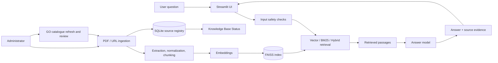

## Repository map

```text
tn-agri-schemes-rag/
├── app.py
├── guardrails.py
├── requirements.txt
├── .env.example
├── .streamlit/config.toml
├── src/
│   ├── ingestion.py
│   ├── qa.py
│   ├── retrieval.py
│   ├── source_catalogue.py
│   └── voice.py
├── tests/
├── data/source_catalogue/
├── data/uploads/
├── data/vector_store/
├── docs/
└── images/
```

Generated uploads, indexes, local environment files, and runtime artefacts should remain excluded by `.gitignore`. Keep the curated seed catalogue files that are part of the project inputs.

## Quick start — Windows CMD

From the repository root:

```bat
py -3.12 -m venv .venv
.venv\Scripts\activate
python -m pip install --upgrade pip
pip install -r requirements.txt
python -m playwright install chromium
copy .env.example .env
notepad .env
streamlit run app.py
```

Add a valid `OPENAI_API_KEY` to `.env`. Never commit real credentials. See [setup and operations](docs/setup-and-operations.md) for configuration and operational guidance.

## Recommended first run

1. Open **Sources & Ingestion**.
2. Upload a trusted scheme PDF or ingest a trusted URL.
3. For Government Orders, refresh the catalogue, review records, and select relevant PDF URLs.
4. Confirm source registration in **Knowledge Base Status**.
5. Ask a question supported by the indexed material.
6. Expand source details and verify the cited passage and page.

Catalogue refresh is separate from question answering; it does not automatically index every listed Government Order.

## Documentation

- [Feature guide](docs/features.md)
- [Architecture](docs/architecture.md)
- [User guide](docs/user-guide.md)
- [Retrieval strategy](docs/retrieval-strategy.md)
- [Testing and verification](docs/testing.md)
- [Setup and operations](docs/setup-and-operations.md)
- [Diagram source](docs/diagrams.md)
- [Screenshot guide](images/README.md)
- [Change history](CHANGES.md)

## Tests

Run:

```bat
python -m pytest -q
```

The recorded development baseline was **25 passing tests**. Rerun the suite on the current checkout after code or dependency changes and update `docs/testing.md` with the actual result.

## Scope and operating model

- Questions are answered from retrieved indexed context; Q&A does not perform a live web search for each question.
- Catalogue records are reviewed and selected before the corresponding GO PDFs are ingested.
- Voice support transcribes a spoken question to editable text; it follows the same safety and retrieval path as typed input.
- PDF extraction uses text extraction and attempts OCR for pages with little extractable text when the local OCR dependency is available.
- Current source ingestion is centred on PDFs and supported web pages/PDF URLs. Treat arbitrary image, video, or embedded-audio indexing as a separate extension unless a dedicated extraction path has been implemented and tested.
- FAISS index data and the SQLite source registry should be backed up together when preserving a local knowledge base.

---

## Visual Tour

### Project Overview

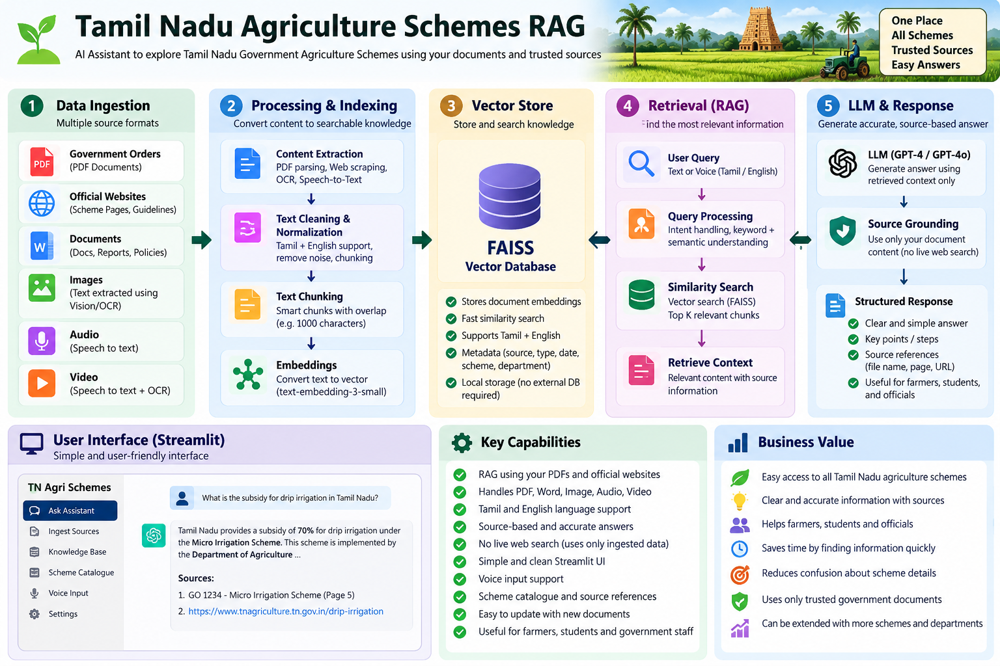

### Application Screenshots

**Home page**

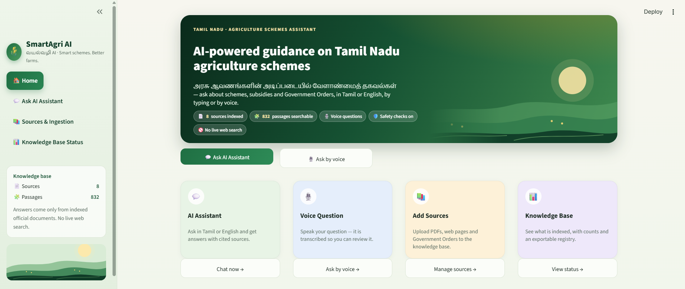

**Ask AI Assistant**

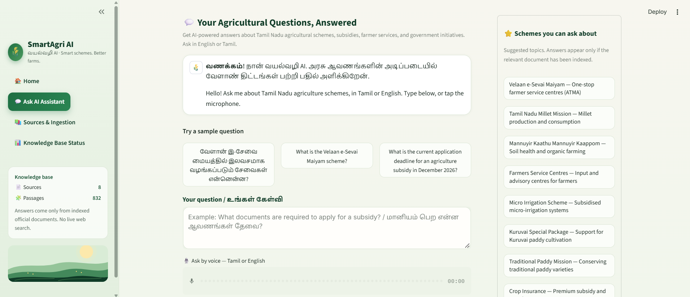

**Source evidence**

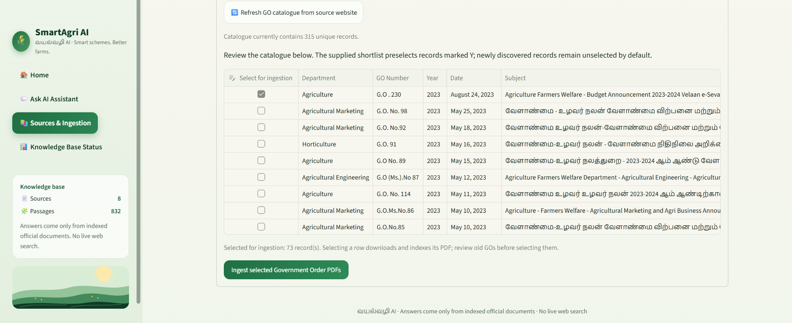

**Sources and ingestion**

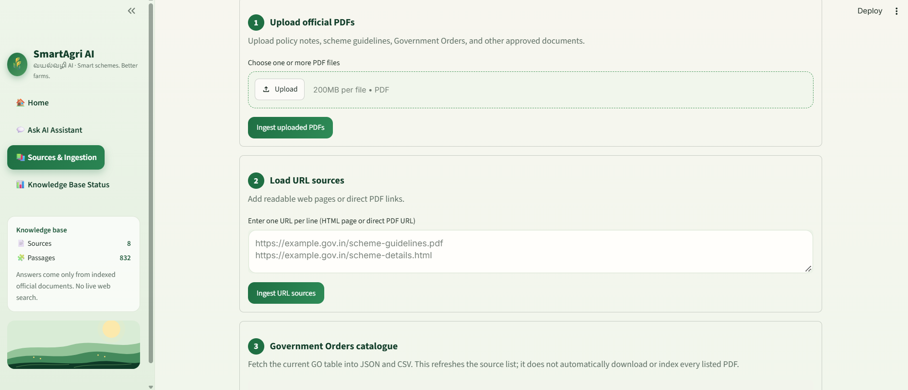

**Knowledge Base Status**

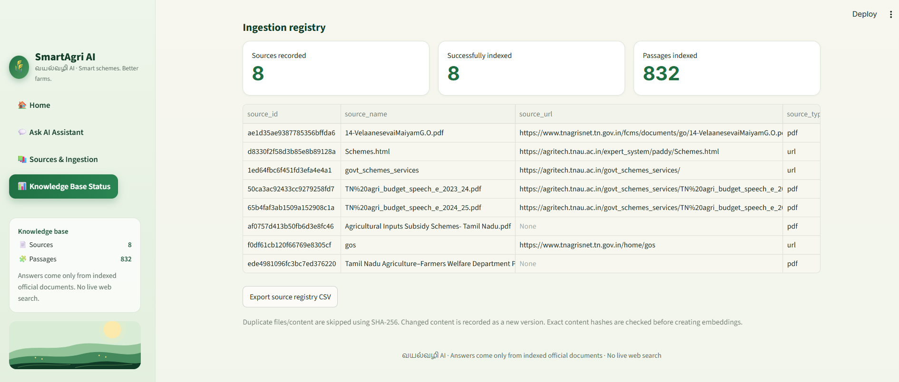

### Technical Diagrams

**System architecture**

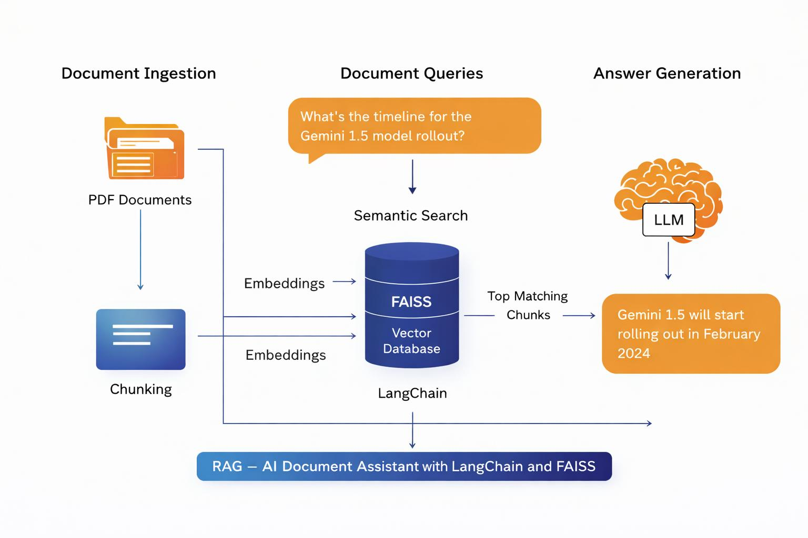

**Document ingestion workflow**

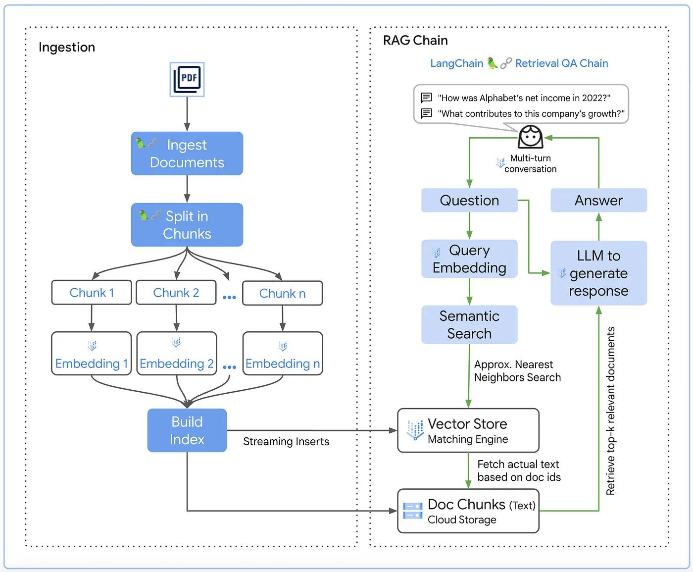

**Question-answering lifecycle**

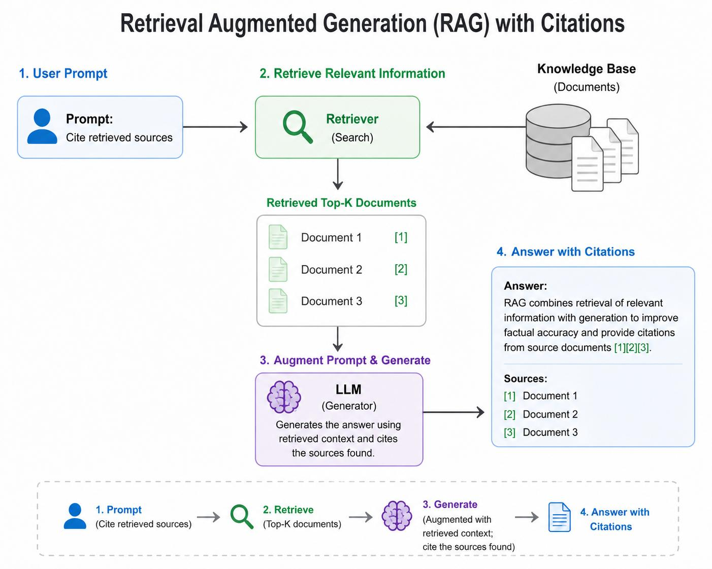

**Retrieval strategy**

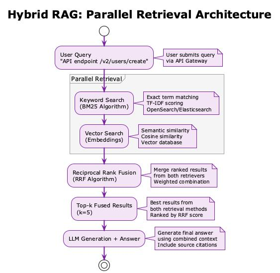

See [docs/](docs/) for detailed technical documentation and editable Mermaid diagrams.
\n