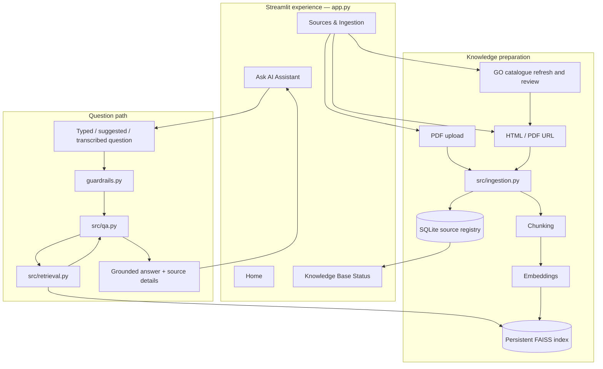
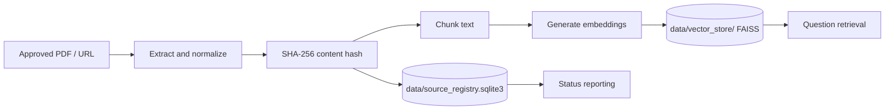
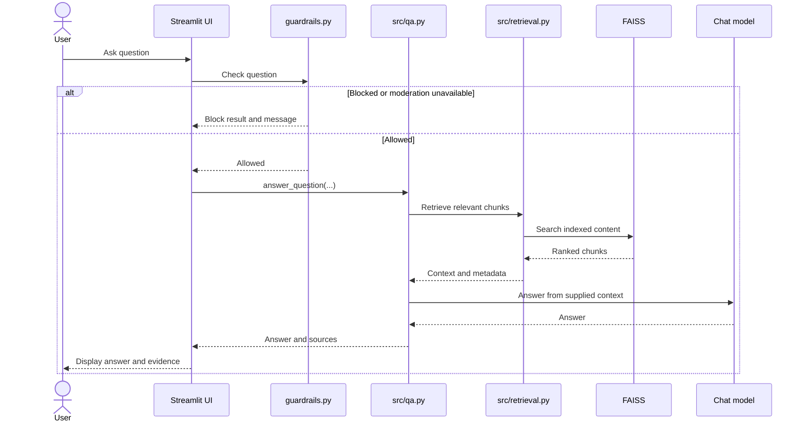

# Architecture

## Design goals
The application separates user experience, input safety, source preparation, retrieval/answer generation, and evidence presentation.

## High-level architecture

## Component responsibilities

| Component | Responsibility |
|---|---|
| `app.py` | Page navigation, chat interaction, source administration, catalogue selection, status display, voice UI, and presentation. |
| `guardrails.py` | Empty-input handling, prompt-injection pattern checks, and moderation gate. |
| `src/ingestion.py` | PDF/URL reading, extraction, normalization, chunking, hashing, index updates, and registry writes. |
| `src/source_catalogue.py` | Government Order catalogue refresh and preparation of records for review. |
| `src/retrieval.py` | Tokenization, query expansion, BM25, year-aware filtering, and RRF ranking. |
| `src/qa.py` | Loads the knowledge base, retrieves context, invokes the chat model, and returns answer/source data. |
| `src/voice.py` | Converts recorded question audio to text. |
| `tests/` | Automated checks for retrieval, catalogue, UI flow, voice, and year-aware behaviour. |

## Persistence

FAISS holds searchable vector representations and associated document data. SQLite stores source-level ingestion metadata, status, and chunk counts. Back up both consistently when preserving a local knowledge base.

## Question lifecycle

## Trust and configuration
- Keep real credentials in `.env` or the hosting platform's secret store, never in Git.
- Catalogue refresh is separate from question answering.
- Question answering uses indexed context and does not perform live web search for each question.
- Treat local index files as runtime data, not source code.
