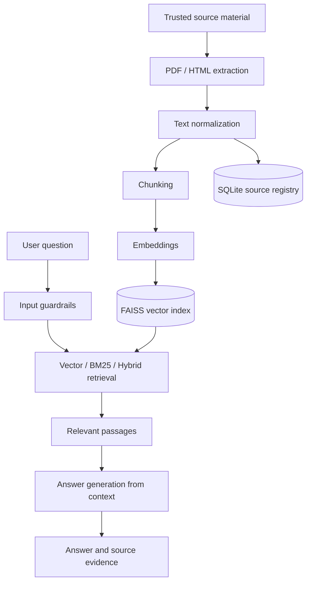
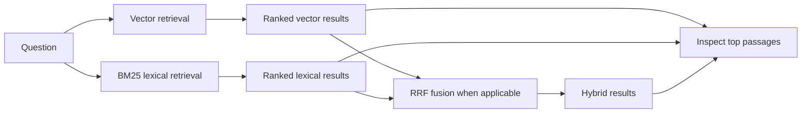
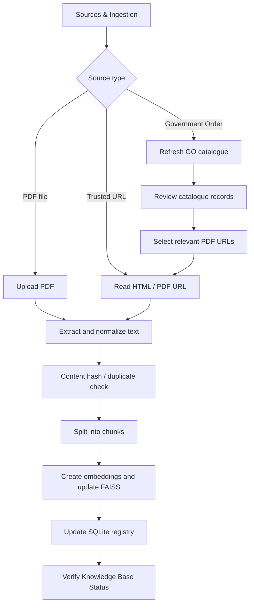

# Editable diagram source

These Mermaid diagrams can be rendered by GitHub and compatible Markdown viewers. Keeping the source in version control makes the diagrams editable.

## End-to-end workflow

## Retrieval comparison

## Administrator workflow

